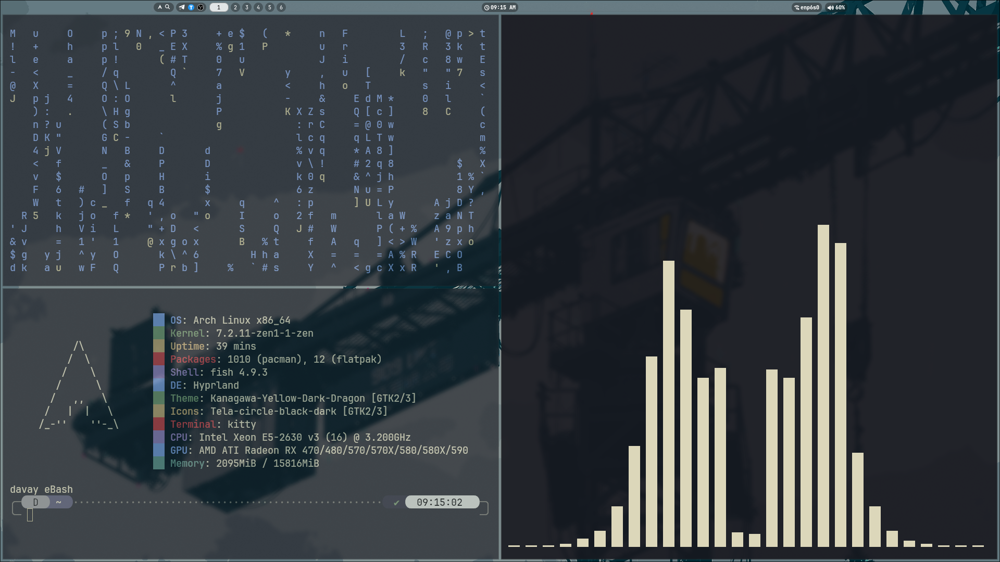
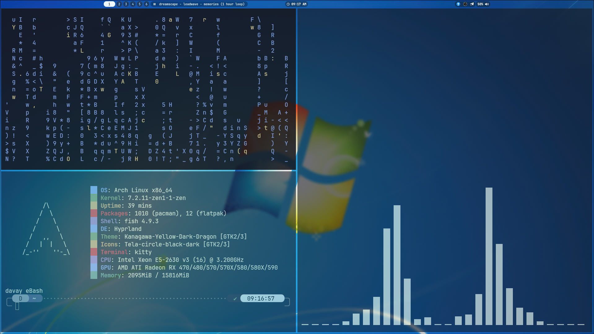
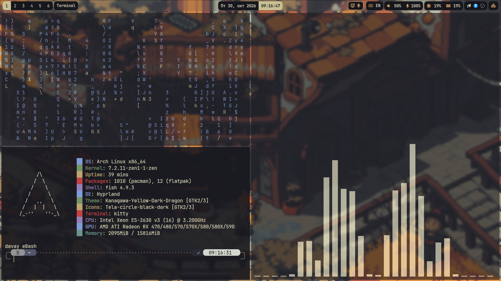
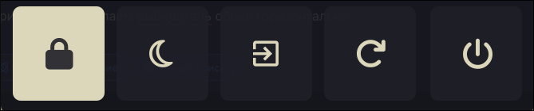
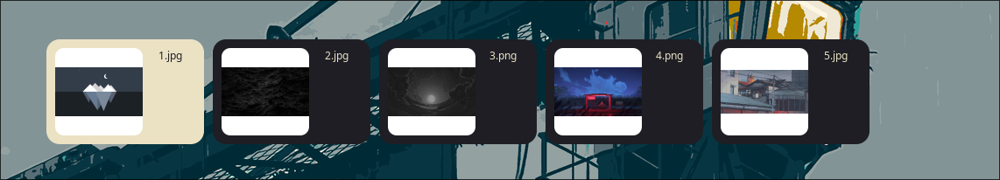
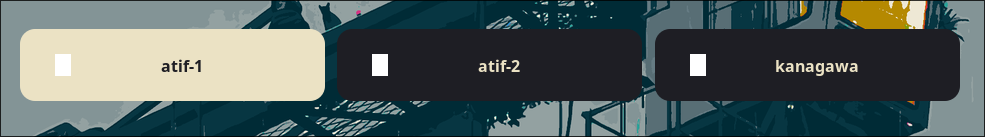

<div align="center">

# 🧑‍💻 Bratanchi-dots

**Мои персональные dotfiles для Arch Linux (Wayland).**

[](https://archlinux.org/)
[](https://hyprland.org/)
[](https://github.com/rebelot/kanagawa.nvim)

*Основной композитор: Hyprland (конфигурация на Lua) • Тема: Kanagawa • Стиль: Острые углы, блюр, минимализм.*

</div>

---

## 📸 Галерея

### Статус-бар (Waybar)
| Atif-2 (Основной) | Atif-1 | Kanagawa |
| :---: | :---: | :---: |
|  |  |  |

### Меню Rofi
| Лаунчер (drun) | Power Menu | Смена обоев | Меню Waybar |
| :---: | :---: | :---: | :---: |
|  |  |  |  |

### Рабочий стол
| Темная тема | Светлая тема |
| :---: | :---: |
|  |  |

---

## ⚙️ О конфигурации

- **Оконный менеджер:** [Hyprland](https://hyprland.org/) (написан на **Lua** для максимальной гибкости).
- **Статус-бар:** [Waybar](https://github.com/Alexays/Waybar) (3 профиля: `atif-1`, `atif-2`, `kanagawa`).
- **Лаунчер и меню:** [Rofi](https://github.com/davatorium/rofi) (запуск приложений, меню выключения, смена обоев и меню Waybar).
- **Терминал:** [Kitty](https://sw.kovidgoyal.net/kitty/).
- **Шелл:** [Fish](https://fishshell.com/) + Tide + Fisher.
- **Уведомления:** [Dunst](https://dunst-project.org/).
- **Файловый менеджер:** Ranger (в конфиге также прописан `nautilus`).
- **Музыка и визуализация:** `rmpc` и `cava` прямо в терминале.

### 🎨 Визуал и анимации
В `hyprland.lua` настроены кастомные кривые (`easeOutQuint`, `almostLinear`), плавные слайды рабочих столов (`slide`, `slidevert` для scratchpad), включен блюр (`vibrancy = 0.1696`) и прозрачность неактивных окон (`0.7`). Скругления отключены (`rounding = 0`) для строгого вида.

---

## ⌨️ Основные горячие клавиши (из `hyprland.lua`)

| Клавиши | Действие |
| :--- | :--- |
| `SUPER + S` | Открыть терминал (Kitty) |
| `SUPER + A` | Открыть меню Rofi (`rofi -show drun`) |
| `SUPER + Q` | Закрыть активное окно |
| `SUPER + B` | Открыть браузер (Firefox) |
| `SUPER + E` | Открыть файловый менеджер |
| `SUPER + M` | Запустить плеер (`rmpc`) |
| `SUPER + L` | Запустить визуализатор (`cava`) |
| `SUPER + W` | Сделать окно плавающим (Float) |
| `SUPER + F` | Переключить Scratchpad (Спец. воркспейс) |
| `SUPER + SHIFT + W` | Сменить обои |
| `SUPER + ALT + B` | Открыть Bluetooth (Blueman) |
| `SUPER + ALT + W` | Меню Waybar |
| `CTRL + ALT + DELETE`| Меню выключения (Rofi Powermenu) |
| `SUPER + 1-0` | Переключение рабочих столов |
| `SUPER + SHIFT + 1-0`| Переместить окно на другой стол |

*(Переключение раскладки: `ALT + SHIFT`)*

---

## 🚀 Установка

1. Склонируйте репозиторий (обратите внимание на регистр букв):
   ```bash
   git clone https://github.com/Bratanchi/bratanchi-dots.git ~/.config/bratanchi-dots
